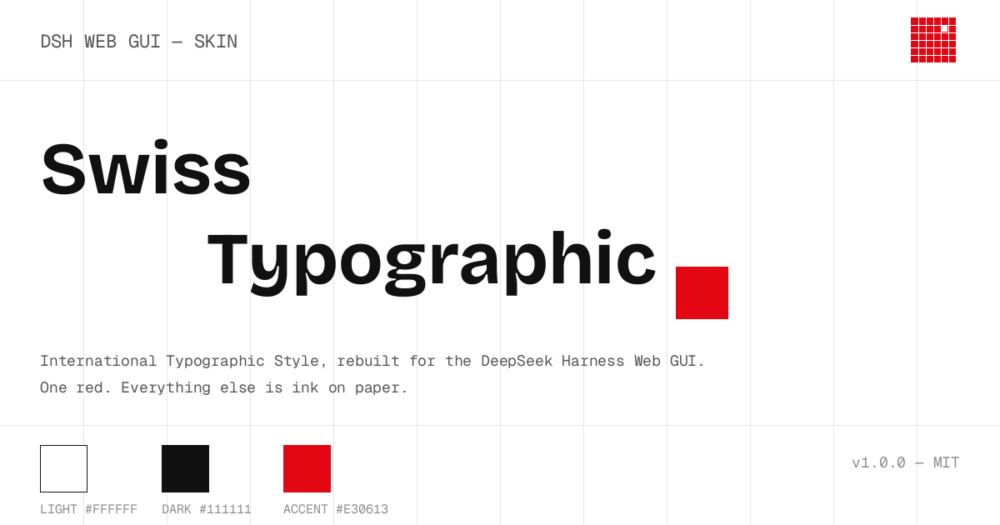
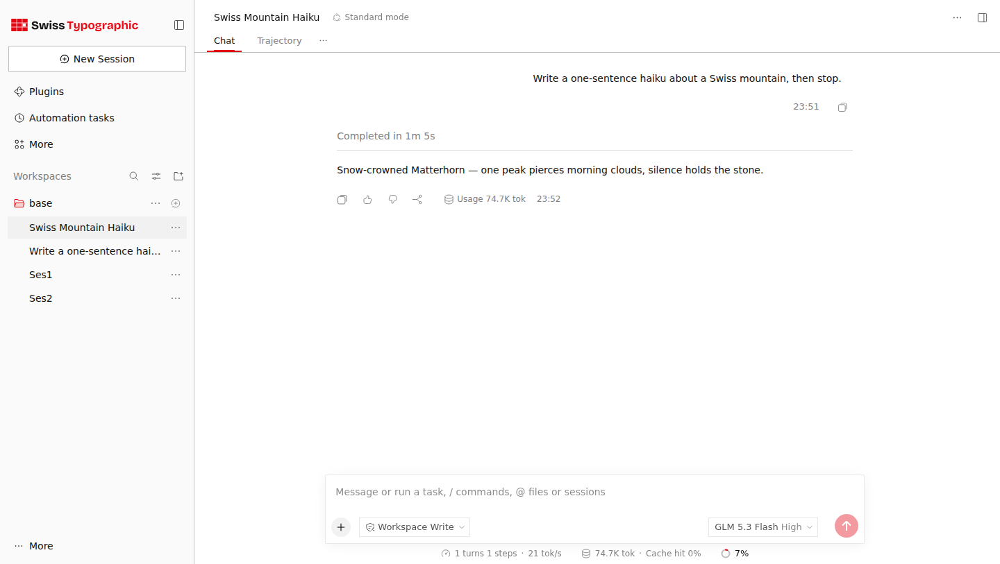
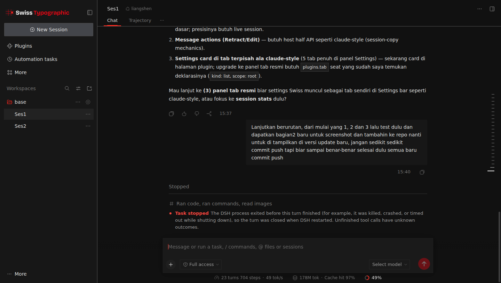
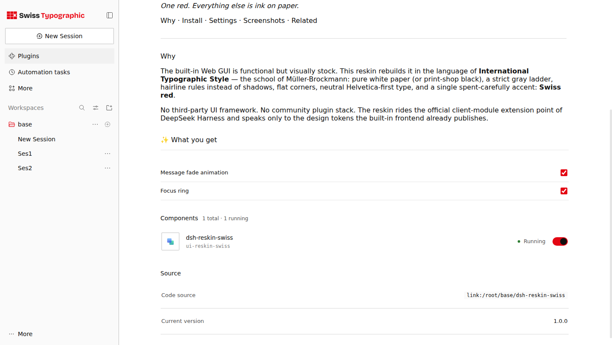

<div align="center">



[](./LICENSE)


**Swiss Typographic — a reskin for the built-in DeepSeek Harness Web GUI.**

*One red. Everything else is ink on paper.*

[Why](#why) · [Install](#-install) · [Settings](#%EF%B8%8F-settings) · [Screenshots](#-screenshots) · [Contributors](#-contributors) · [Related](#-related)

</div>

---

## Why

The built-in Web GUI is functional but visually stock. This reskin rebuilds it
in the language of **International Typographic Style** — the school of
Müller-Brockmann: pure white paper (or print-shop black), a strict gray ladder,
hairline rules instead of shadows, flat corners, neutral Helvetica-first type,
and a single spent-carefully accent: **Swiss red**.

No third-party UI framework. No community plugin stack. The reskin rides the
official client-module extension point of DeepSeek Harness and speaks only to
the design tokens the built-in frontend already publishes.

## ✨ What you get

| | Light — paper | Dark — print shop |
|---|---|---|
| Canvas | `#FFFFFF` | `#111111` |
| Ink | `#111111` | `#F5F5F5` |
| Accent | `#E30613` | `#FF2A1F` |

- **Flat & ruled** — radius pressed to 0–2px, hairline borders replace shadows
- **Brand replaced** — DeepSeek whale & wordmark become the Swiss grid mark
  and a *Swiss Typographic* wordmark
- **Typography** — Helvetica Neue → Inter → full CJK fallback chain
- **Restrained motion** — one 160 ms message fade (honors `prefers-reduced-motion`)
- **Visible focus** — an unmistakable red keyboard focus ring
- **Light + dark** — follows the shell's theme automatically
- **Swiss motion system** — a 160 ms theme flip, 100 ms button press, composer
  hairline that darkens while you type, sidebar active-bar slide-in; every
  transition under 200 ms and the whole set collapses under prefers-reduced-motion

## 📷 Screenshots

<div align="center">

**Light — paper**



**Dark — print shop**



</div>

## 📦 Install

Requires [DeepSeek Harness](https://github.com/deepseek-ai/deepseek-harness) ≥ 0.2.2-rc.1.

```sh
git clone https://github.com/0xmrxp/dsh-reskin-swiss.git
cd dsh-reskin-swiss
dsh plugin --profile web add .
```

Restart the Web UI (or reload the page). Uninstall any time:

```sh
dsh plugin --profile web remove dsh-reskin-swiss
```

## ⚙️ Settings

Two toggles, live — no reload needed:

| Setting | Default | Effect |
|---|---|---|
| `messageFade` | `true` | 160 ms message enter animation |
| `focusRing` | `true` | red keyboard focus ring |

Change them through your profile's patch file:

```yaml
- insert:
    - id: ui-reskin-swiss
      name: 'dsh-reskin-swiss'
      config:
        messageFade: true
        focusRing: true
```

Values persist across restarts and hot-reload. A settings card with the same
toggles also renders on the plugin's page under **Plugins** in the Web UI:

<div align="center">

</div>

## 🧩 How it works

One client stylesheet remaps the design tokens the built-in frontend already
publishes (`--dsw-alias-*`); brand marks are repainted on the same footprint;
two tiny observers mirror light/dark and sidebar state; the host half serves
the current settings over a local HTTP endpoint. Original nodes are never
removed and nothing touches React — uninstalling restores the stock look
exactly.

<details>
<summary>More detail</summary>

- Light values scope under `html[data-reskin-swiss] body` (0-1-1 — beats the
  official `body` definitions at 0-0-1 regardless of load order); dark values
  under `html[data-reskin-swiss] body[data-ds-dark-theme]`
- Light/dark and sidebar state are mirrored onto `data-reskin-swiss-*`
  attributes by two attribute-filtered `MutationObserver`s (read-only against
  official attributes)
- Settings persist in `$DSH_HOME/dsh-reskin-swiss/config.json`, served at
  `GET /dsh-reskin-swiss/config`, polled by visible tabs every 4 s
- Design philosophy: see [`assets/DESIGN-PHILOSOPHY.md`](./assets/DESIGN-PHILOSOPHY.md)

</details>

## 🤝 Contributing

See [CONTRIBUTING.md](./CONTRIBUTING.md) — design discipline first, motion
budget, no new client dependencies, and a stock-profile reproduction check.

## 🔗 Related

- [**dsh-skin-swiss-typographic**](https://github.com/0xmrxp/dsh-skin-swiss-typographic) —
  the same design packaged as a skin-center v2 skin (asset directory, for users
  of the community skin center with theme picker UI)

## 👥 Contributors

<table>
<tr>
<td align="center">
<a href="https://github.com/0xmrxp"><br/><sub><b>0xmrxp</b></sub><br/><sub>design & code</sub></a>
</td>
<td align="center">
<a href="https://github.com/0xmrxp/dsh-reskin-swiss/issues"><br/><sub><b>you?</b></sub><br/><sub>see CONTRIBUTING.md</sub></a>
</td>
</tr>
</table>

<!-- CONTRIBUTORS:README (auto-maintained; add a cell per contributor) -->

<div align="center">

[MIT](./LICENSE) © 0xmrxp

</div>
